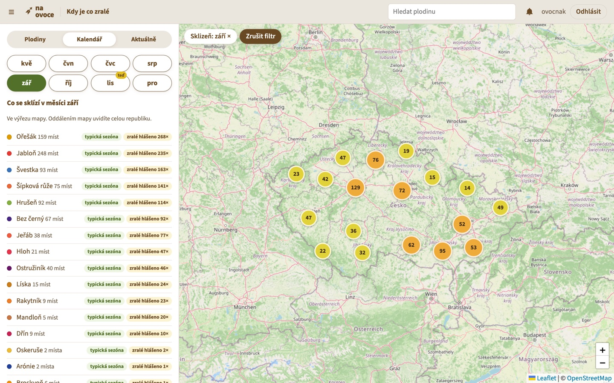
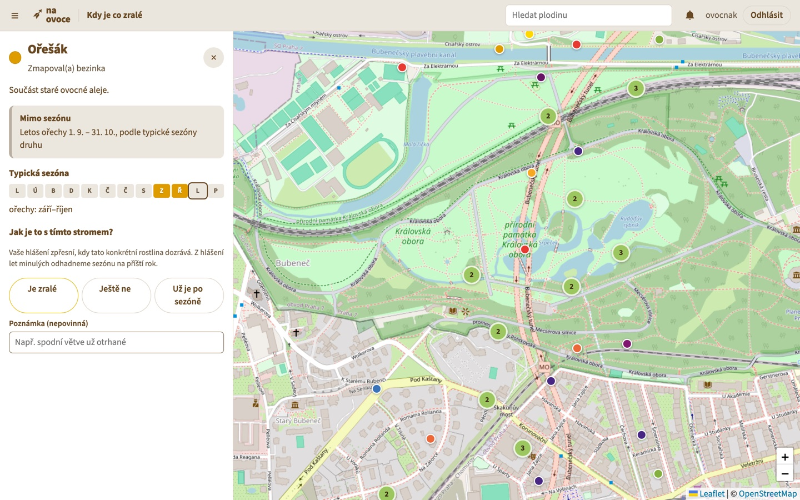
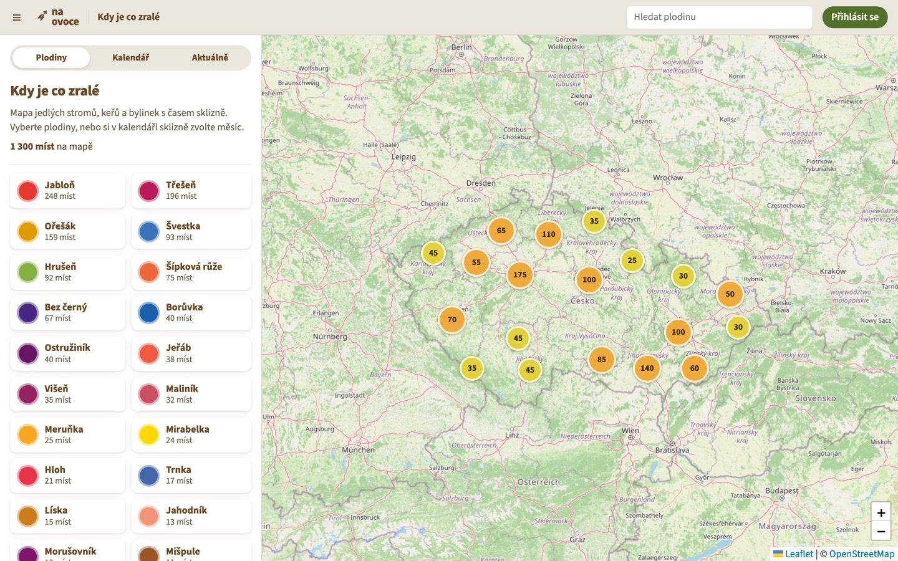
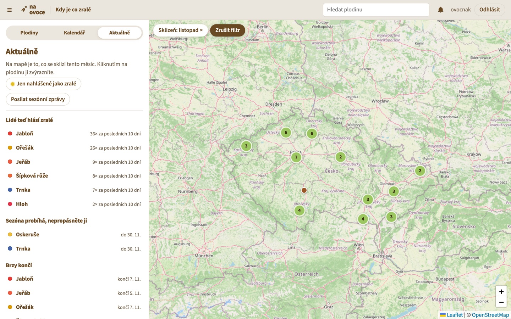
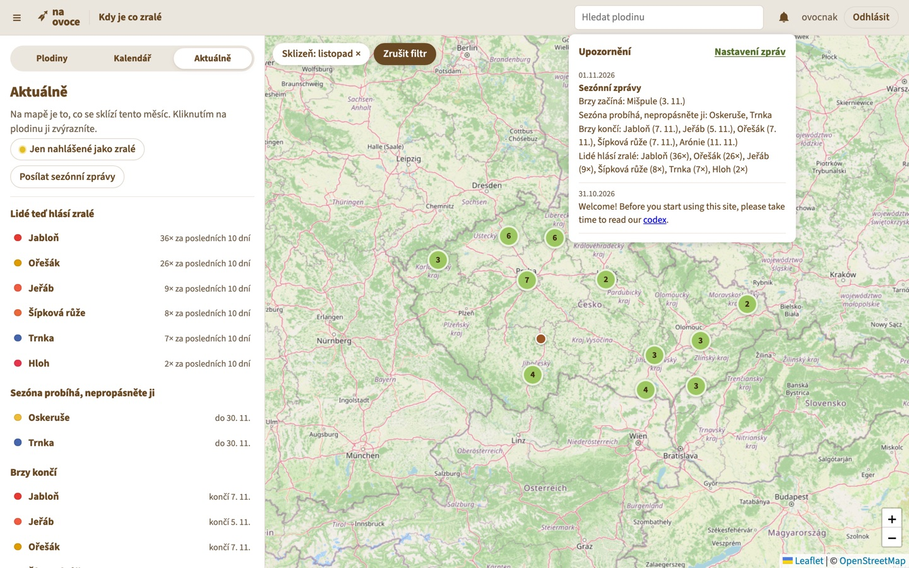
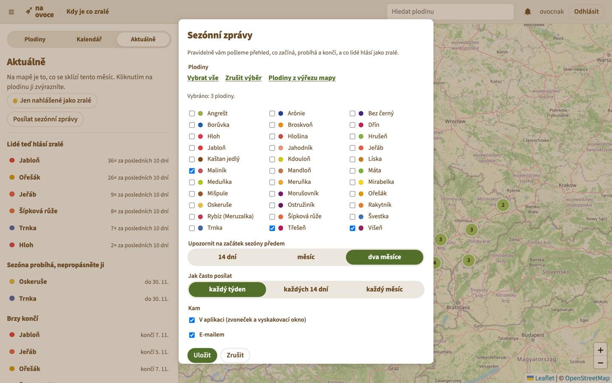
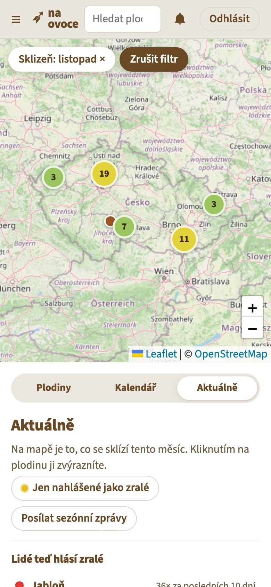

# Mise: Kdy je co zralé

Návrh nové funkce pro mapu [Na ovoce](https://www.na-ovoce.cz/) a její
funkční prototyp. Návrh připravil Jakub Burian
([@Burizon](https://github.com/Burizon)) v listopadu 2026.

Tento dokument popisuje, **co** chceme a **proč**: problém, uživatele,
podobu funkce, rozhodnutí z prototypu a cesty, jak funkci dostat do
dnešní aplikace Na ovoce. **Jak** v kódu pracovat, popisuje
[AGENTS.md](AGENTS.md). Připravené úkoly a prompty pro AI najdete
v [TODO.md](TODO.md).

## Proč

Mapa Na ovoce skvěle ukazuje, **kde** rostou jedlé stromy, keře a bylinky.
Neříká ale, **kdy** plodí. Kdo se v rostlinách nevyzná, neví, jestli má smysl
jít k třešni v červnu, nebo k ořešáku v září. Mapa se proto snadno stane
seznamem míst, ke kterým člověk nikdy nevyrazí.

Autor návrhu se nedávno přestěhoval do Prahy. Hodně jeho kamarádů chodí do
sadů a sbírá zralé ovoce a díky mapě ví, kde rostliny jsou. V tom, kdy co
plodí, se ale nevyzná. Chtěl by, aby mu telefon sám napsal například
„Právě začíná sezóna mirabelek“. Pak si otevře aplikaci, najde nejbližší
stromy a vyrazí.

Takových lidí je podle nás hodně: lidé ve městě, nováčci, rodiny s dětmi.
Funkce jim sníží práh a mapě přinese lidi, kteří ji budou používat celou
sezónu, ne jednou.

## Cíl

Mapa odpoví na tři otázky:

1. **Co se sklízí teď a co začne brzy?**
2. **Kdy plodí tahle konkrétní rostlina?** Ne jen druh obecně, ale tenhle
   strom v téhle aleji.
3. **Dá mi aplikace vědět, až začne sezóna toho, co mě zajímá?** A to
   i tehdy, když je aplikace zavřená.

## Pro koho

- **Nováček a člověk ve městě** chce vědět, kam a kdy vyrazit, a nechce
  studovat botaniku.
- **Zkušený sběrač** ví, kdy je strom zralý, a jedním klepnutím to řekne
  ostatním.
- **Spolek Na ovoce** získá data o skutečném dozrávání po celé republice.
  Hodí se pro osvětu, péči o sady i pro výběr odrůd.

## Co funkce umí

### 1. Typická sezóna každého druhu

Každý druh má typické období sklizně: měsíc od–do, případně víc částí
rostliny, například plody a listy. Prototyp obsahuje typické sezóny všech
33 druhů z mapy ([fixtures/seasons.json](fixtures/seasons.json)). Původní
backend na to měl model `herbarium.Season`, jen byl prázdný.

### 2. Hlášení zralosti od lidí

U každé rostliny může přihlášený člověk nahlásit **Je zralé**, **Ještě ne**,
nebo **Už je po sezóně**, s volitelnou poznámkou. Jeden člověk má na jednu
rostlinu jedno hlášení za den a opakované hlášení ho přepíše.

### 3. Odhad sezóny konkrétní rostliny

Pro každou rostlinu odhadujeme letošní okno sklizně v tomto pořadí:

1. **letošní hlášení zralosti**, když už nějaká jsou;
2. **medián z minulých let**: kdy lidé tuto rostlinu hlásili jako zralou;
3. **typická sezóna druhu**, když o rostlině nic nevíme.

Čerstvé hlášení (nejvýš 10 dní staré) má vždy přednost před odhadem, protože
nejlíp to ví člověk, který pod stromem stojí. Raná třešeň v teplém městě tak
postupně dostane jinou sezónu než pozdní třešeň na horách.

### 4. Mapa a panel se třemi kartami

Rozhraní vychází z dnešní [mapy Na ovoce](https://map.na-ovoce.cz/): vlevo
panel, vpravo mapa celé republiky se shluky bodů.

- **Plodiny** filtruje mapu podle druhů. Na začátku se vždy ukazuje celá
  mapa.
- **Kalendář** nabízí měsíce jako tlačítka. Měsíce, kdy se nic nesklízí,
  se nenabízejí, v prototypu tedy jen květen–prosinec. Pod tlačítky je seznam
  toho, co se v daném měsíci ve výřezu mapy sklízí, s jasným rozlišením
  **typická sezóna** a **jen podle hlášení**. Počet hlášení zralosti je
  uvedený zvlášť. Pod seznamem je přehled sezón všech druhů.
- **Aktuálně** ukazuje, co lidé teď hlásí jako zralé, co právě začalo, co
  probíhá, co brzy končí a co brzy začne.

Přepnutím karty se filtr vždy zruší, takže mapa nikdy nezůstane nečekaně
prázdná. Filtr jde zrušit i tlačítkem **Zrušit filtr** nad mapou.

### 5. Sezónní zprávy

Přihlášený člověk dostává pravidelný přehled o plodinách, které si vybral:

- **co právě začalo**,
- **co začne brzy**: 14 dní, měsíc, nebo dva měsíce předem podle nastavení,
- **co probíhá**, s výzvou „nepropásněte“,
- **co brzy končí**,
- **co lidé hlásí jako zralé**.

V nastavení si člověk zvolí:

- **plodiny**: zaškrtne jen ty, o kterých chce vědět; nic nezaškrtnuté
  znamená všechny;
- **předstih**: 14 dní, měsíc, nebo dva měsíce;
- **frekvenci**: každý týden, každých 14 dní, nebo každý měsíc;
- **kanál**: v aplikaci, e-mailem, nebo obojí.

Ve výchozím stavu jsou zapnuté všechny plodiny, předstih měsíc, zprávy jednou
za 14 dní a jen v aplikaci.

### 6. Upozornění i při zavřené aplikaci (cíl, v prototypu zatím není)

Hlavní kanál mají být **push notifikace mobilní aplikace**, které dorazí, i
když je aplikace zavřená. Například:

> **Na ovoce:** Právě začíná sezóna mirabelek. Ve vašem okolí jich je 12.

Klepnutím se otevře mapa s vyfiltrovanou plodinou. Platí přitom:

- **E-mail jen na přání.** E-maily lidi spíš obtěžují, proto je e-mail
  volitelný a ve výchozím stavu vypnutý.
- **Na webu volitelně Web Push.** Pro funkci není nutný.
- **Prototyp zatím doručuje dvěma kanály:** do schránky zpráv v aplikaci
  (zvoneček s vyskakovacím oknem) a e-mailem. Push notifikace jsou připravené
  jako úkol v [TODO.md](TODO.md).

Telefon na obrázku níže ukazuje kartu Aktuálně v mobilním zobrazení webu.

## Rozhodnutí z prototypu a proč

Prototyp prošel dvěma koly proklikání a připomínek. Z nich vzešla tato
rozhodnutí:

| Rozhodnutí | Proč |
|---|---|
| Hlídat **druhy plodin**, ne oblasti na mapě | Lidé přemýšlejí „chci vědět o třešních“, ne „hlídej mi tento čtverec“. Hlídání oblastí bylo v první verzi a bylo zbytečně složité. |
| Upozornění **v aplikaci a push**, e-mail jen volitelně | E-maily obtěžují. Upozornění má přijít tam, kde člověk mapu používá. |
| Předstih 14 dní, měsíc, nebo dva měsíce | Stačí na naplánování víkendu a nevyžaduje přesné datum. |
| Frekvence každý týden, 14 dní, nebo měsíc | Jedna souhrnná zpráva místo upozornění u každé rostliny zvlášť. |
| Kalendář jen s měsíci, kdy se něco sklízí | Prázdné zimní měsíce nic neřeknou. |
| Kalendář filtruje jen podle měsíce | Dvojí filtr, podle měsíce i podle druhu, mátl. Druhy filtruje karta Plodiny. |
| Přepnutí karty zruší filtr | Mapa nesmí nečekaně zůstat prázdná. |
| U každé položky odlišit „typická sezóna“ a „podle hlášení“ | Člověk má vědět, jestli jde o obecný údaj, nebo o zkušenost lidí. |
| Výpočty v kalendářních dnech nepřestupného roku | Medián z různých let se jinak posouvá o přestupný den. |

## Jak to funguje uvnitř

Podrobnosti pro vývojáře a AI jsou v [AGENTS.md](AGENTS.md). Ve zkratce:

- **Data**:
  - `herbarium.Season` drží typickou sezónu druhu: část rostliny, první
    měsíc a délku v měsících;
  - `harvest.RipenessReport` drží hlášení zralosti;
  - `harvest.SeasonWatch` drží nastavení sezónních zpráv uživatele.
- **Logika** je oddělená od databáze v
  [src/harvest/seasons.py](src/harvest/seasons.py), takže jde přenést i do
  jiného systému. Dotazy do databáze jsou v
  [src/harvest/services.py](src/harvest/services.py).
- **Fáze sezóny** pro zprávy:
  - *brzy začíná*: do zvoleného předstihu;
  - *právě začala*: prvních 14 dní;
  - *brzy končí*: posledních 14 dní;
  - *probíhá*: mezi tím.

  Okna rostlin téhož druhu, které dozrávají jedna po druhé s mezerou nejvýš
  21 dní, se spojí do jedné sezóny druhu.
- **API** (rozšíření stávajícího `/api/v1/`, nic stávajícího se nemění):

| Endpoint | Co dělá |
|---|---|
| `GET /api/v1/fruit/?month=1-12\|now&ripe=1` | Filtr mapy podle měsíce sklizně a podle čerstvého hlášení zralosti |
| `GET, POST /api/v1/fruit/<id>/season/` | Sezóna konkrétní rostliny a hlášení zralosti |
| `GET /api/v1/harvest/calendar/?bbox=` | Kalendář sklizně pro výřez mapy |
| `GET /api/v1/harvest/news/?lead_days=` | Co začíná, probíhá, končí a co lidé hlásí jako zralé |
| `GET, PUT, PATCH /api/v1/harvest/watch/` | Nastavení sezónních zpráv přihlášeného uživatele |
| `GET /api/v1/users/me/messages/`, `POST …/read/` | Zprávy v aplikaci (zvoneček) |

- **Rozesílání**: příkaz `python src/manage.py send_season_news` se má
  spouštět jednou denně. Každému uživateli pošle zprávu jen tehdy, když od
  minulé uplynula zvolená frekvence.

## Jak funkci dostat do vaší aplikace

Mapa i mobilní aplikace Na ovoce dnes běží na platformě
[Mapotic](https://www.mapotic.com/). Tento repozitář je původní open-source
backend, který Na ovoce používalo do roku 2022. Dnes je archivovaný. Prototyp jsme postavili nad ním,
protože je veřejný a dá se na něm funkce ukázat, vyzkoušet a otestovat.
Funkci jsme navrhli tak, aby nebyla na tomto kódu závislá.

Možné cesty:

1. **Zadání pro Mapotic.** Tento dokument, snímky obrazovky a API slouží jako
   specifikace. Mapotic posoudí, co z toho jeho platforma umí: sezóny
   u kategorií, hlášení u bodů, filtr podle měsíce a push notifikace podle
   kategorií. Prompt, který zadání připraví, je v [TODO.md](TODO.md).
2. **Doplňková služba vedle Mapoticu.** Logika sezón a sezónních zpráv běží
   samostatně a čte místa z Mapoticu. Záleží na tom, jaké API a jaké
   možnosti push notifikací Mapotic nabízí. To jsme neověřovali.
3. **Vlastní vývoj na tomto kódu.** Prototyp je kompletní, ale backend
   potřebuje upgrade na podporované verze Djanga a Pythonu.

Doporučujeme začít první cestou. Nejdřív zjistit, co umí Mapotic, a podle
toho rozhodnout, jestli stačí, nebo je potřeba doplňková služba.

## Data

- **Typické sezóny** v [fixtures/seasons.json](fixtures/seasons.json) jsme
  sestavili z běžně dostupných zdrojů. Před nasazením je má zkontrolovat
  někdo, kdo se v rostlinách vyzná. Nejméně jisté jsou líska, mandloň,
  hlošina, máta a meduňka.
- **Místa** dodá spolek: celá Česká republika, desítky tisíc bodů. Snímky
  obrazovky v tomto PR používají vymyšlená ukázková data, zhruba 1 300 míst
  po celé republice. Ta v PR nejsou.
- **Hlášení zralosti** jsou nová data. U hlášení se ukazuje přezdívka autora
  stejně jako u zmapovaných míst.

## Co prototyp není

- **Není hotový produkt.** Backend běží na Djangu 2.2 a Pythonu 3.9, které
  už nemají bezpečnostní podporu.
- **Push notifikace ani denní plánovač** zatím nejsou. Jsou to úkoly
  v [TODO.md](TODO.md).
- **Výkon** s desítkami tisíc míst jsme neměřili. Kalendář a sezónní zprávy
  bude potřeba ukládat do mezipaměti.
- **Přidávání nových míst** (tlačítko „Přidat značku“) do této funkce
  nepatří. Vaše aplikace ho už má a původní API ho umí.

## Jak poznáme, že to funguje

- Kolik lidí má zapnuté sezónní zprávy a pro kolik plodin.
- Kolik hlášení zralosti přibude za sezónu a z kolika míst.
- Kolik lidí otevře mapu z upozornění.
- Jestli se odhad sezóny konkrétních rostlin rok od roku zpřesňuje oproti
  typické sezóně.

## Odkazy

- [AGENTS.md](AGENTS.md): jak v repozitáři pracovat, spouštět a testovat.
- [TODO.md](TODO.md): připravené úkoly s prompty pro AI.
- [web/README.md](web/README.md): prototyp webového rozhraní.
- [docs/harvest-seasons/](docs/harvest-seasons/): snímky obrazovky.
