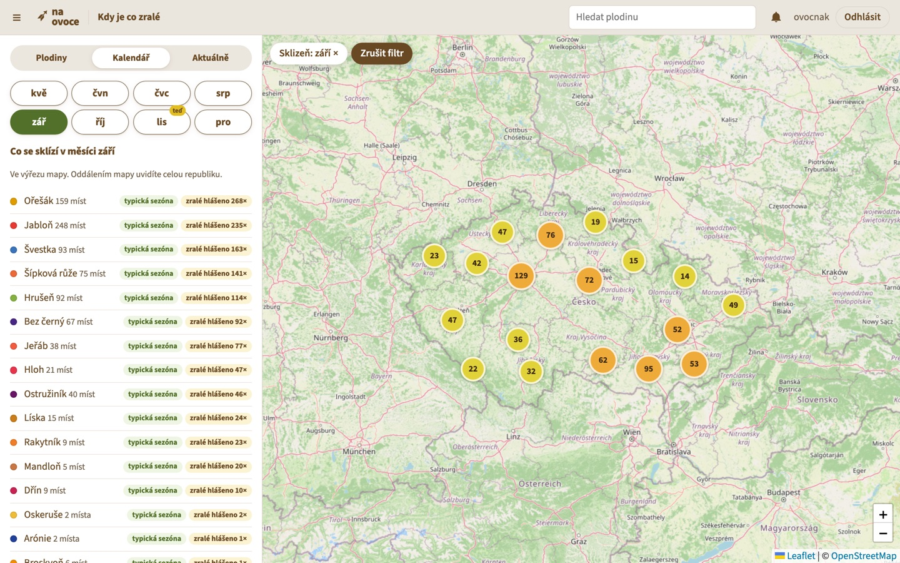

Na-ovoce.cz Backend
===================

Na ovoce aims to become a web community platform that maps fruit trees, fruit bushes and
herbs in wild and public spaces. At the same time its activities increase awareness
of traditional varieties among the general public and contribute to their retention
in the landscape.

## _This repository is no longer maintained and is preserved for curious passers-by only._ 

Starting 2022-04-21 [Na-ovoce.cz](https://www.na-ovoce.cz/) gave up self-funded custom development
and switched to [Mapotic.com](https://www.mapotic.com/) as a mapping provider.

## 2026: Kdy je co zralé (prototyp)

Branch `feature/harvest-seasons` adds a prototype of *when to harvest*: typical harvest seasons
of all kinds, ripeness reports from people, a map filter by harvest month and season news
by kind, meant as push notifications in the mobile app.

Větev `feature/harvest-seasons` přidává prototyp funkce „Kdy je co zralé“:
typické sezóny sklizně, hlášení zralosti od lidí, filtr mapy podle měsíce
sklizně a sezónní zprávy o vybraných plodinách. V mobilní aplikaci mají
chodit jako push notifikace i při zavřené aplikaci.

- [MISSION.md](MISSION.md): co a proč, rozhodnutí a jak funkci dostat do dnešní aplikace;
- [TODO.md](TODO.md): úkoly s připravenými prompty pro AI;
- [AGENTS.md](AGENTS.md): jak v repozitáři pracovat, spouštět a testovat;
- [web/](web/): prototyp webového rozhraní.

I hereby thank the contributors:

* [flaiming](https://github.com/flaiming)
* [stlk](https://github.com/stlk)
* [twentyfortysix](https://github.com/twentyfortysix)
* [PetrDlouhy](https://github.com/PetrDlouhy)
* [timthelion](https://github.com/timthelion)
* [niccokunzmann](https://github.com/niccokunzmann)
